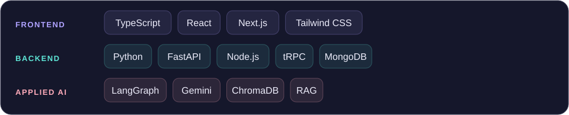

  

  I build <b>web applications</b> and explore <b>applied AI</b>. 
  React interfaces, typed APIs, real-time experiences, and agent workflows.

  
  &nbsp;
  

## Selected work

  
  

  
  

<b>Under the hood → architecture & engineering decisions</b>

- **[Resume Intelligence](https://github.com/aastik7/Multi-Agent-Resume-Intelligence-Platform#system-architecture)** — six LangGraph stages, Pydantic-validated outputs, exact and semantic matching, and progress streamed from FastAPI to Next.js.
- **[Bank Assist](https://github.com/aastik7/AI-RAG-Banking#system-design)** — page-level citations, bounded query rewriting, abstention, idempotent ingestion, and retrieval traces.
- **[HippoKart](https://github.com/aastik7/hippokart)** — authentication, seller listings, persistent carts, and admin review with tRPC and Payload CMS.
- **[Portfolio source](https://github.com/aastik7/Portfolio-Website)** — React, Three.js, Framer Motion, Tailwind CSS, and Vite.

**Toolkit**

- Frontend: TypeScript, React, Next.js, Tailwind CSS.
- Backend: Python, FastAPI, Node.js, tRPC, MongoDB.
- Applied AI: LangGraph, Gemini, ChromaDB, RAG.

## My toolkit

  <b>Also built</b> &nbsp; <a href="https://github.com/aastik7/Realtime-Device-Tracker">Real-time Location Tracker</a> &nbsp; · &nbsp; <a href="https://github.com/aastik7/Chess">Multiplayer Chess</a>

  Interested in full-stack development and AI-powered products. <a href="https://aastik7.github.io/Portfolio-Website/#contact">Let's build something useful ↗</a>

